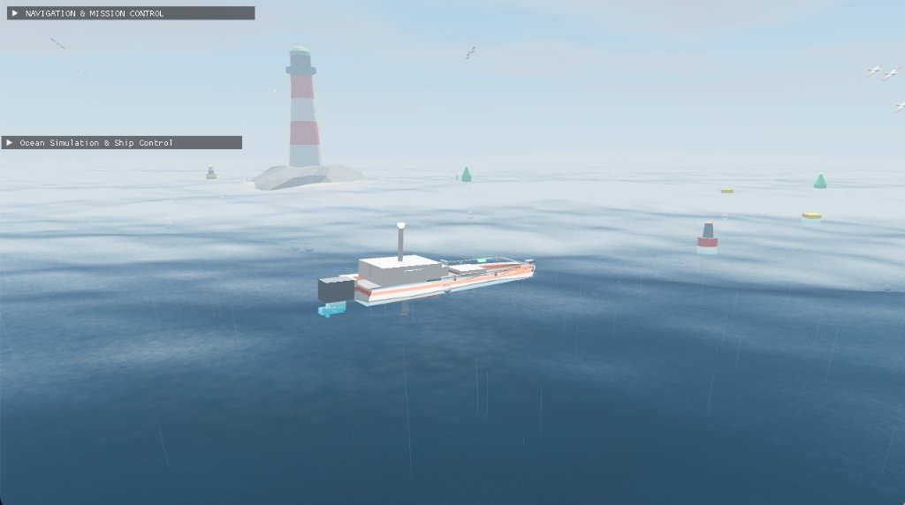
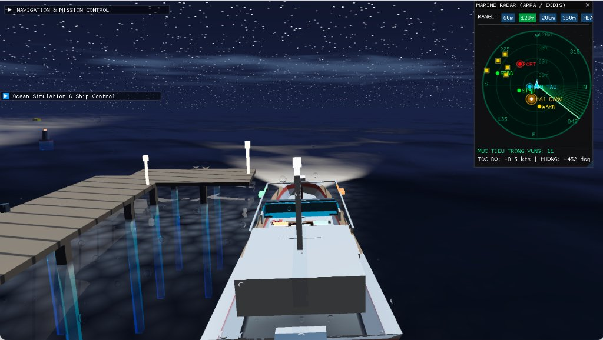
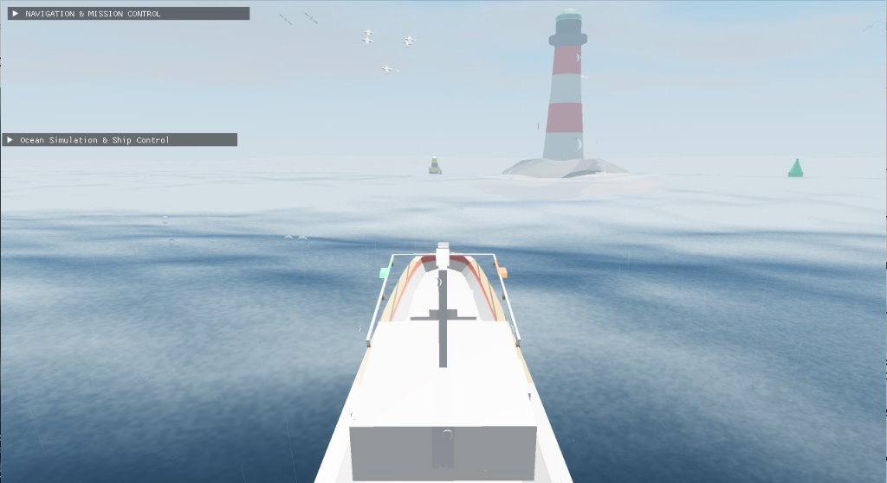

# OceanWave3D - Photorealistic 3D Ocean & Marine Simulator

[](https://en.wikipedia.org/wiki/C%2B%2B17)
[](https://www.opengl.org/)
[%20%7C%20Linux%20%7C%20Windows-lightgrey.svg)](https://github.com/)
[](LICENSE)

**OceanWave3D** là một hệ thống mô phỏng đồ họa đại dương 3D thời gian thực (Real-Time Ocean Simulation & Marine Simulator) hiệu năng cao, được phát triển bằng **C++17**, **OpenGL 4.1 Core**, **GLM**, **GLFW**, **Dear ImGui** và **OpenAL**.

Chương trình tái hiện chuyển động thủy động lực học sóng biển sâu, nội thất buồng lái 3D chân thực, quần thể đất liền duyên hải (Mainland Coastline) hùng vĩ, hệ thống cầu cảng & neo tàu thông minh, radar hàng hải quân sự ECDIS/ARPA, chu kỳ nhật dạ 24h và hệ thống thời tiết bão biển sống động.

---

## 📸 Hình ảnh Trải nghiệm Thực tế (Screenshots)

### 1. Đại dương Biển sâu & Thủy động lực học Sóng Gerstner

*Mặt biển sâu chân thực với phổ sóng JONSWAP/Phillips 16 thành phần, phản xạ không gian màn hình (SSR), tán xạ dưới bề mặt và bọt biển Jacobian.*

---

### 2. Cầu Cảng Hải Đăng, Neo Thuyền & Radar ARPA Ban Đêm

*Cầu cảng gỗ 34m bên đảo hải đăng rực sáng dưới bầu trời đêm, hệ thống buộc dây neo thuyền an toàn và màn hình Marine Radar quét 360°.*

---

### 3. Nội thất Buồng Lái 3D (Cockpit View) & Bảng Táp-lô Đèn Dạ Quang

*Góc nhìn buồng lái từ ghế thuyền trưởng: vô lăng gỗ Mahogany, cần gạt ga, đồng hồ đo tốc độ / la ban analog sáng đèn, kính chắn gió có cần gạt nước.*

---

### 4. Chu kỳ Hoàng hôn & Bầu trời Mây Thủ tục (Procedural Sky)
*Hoàng hôn trên đại dương với ánh sáng tán xạ Rayleigh/Mie, chuyển động mây động và chim hải âu chao lượn quanh ngọn hải đăng.*

---

## ⚓ Hướng Dẫn Chi Tiết Cách Đậu Thuyền (Docking Guide)

Hệ thống cầu cảng được thiết kế cơ chế **Neo Thuyền Thông Minh (Smart Mooring)** hỗ trợ cập bến mạn trái hoặc mạn phải của cầu cảng dọc theo chiều dài 34 mét.

```
                  ĐẤT LIỀN & LÀNG CHÀI
                     │  (Mainland)
                     ▼
          ┌───────────────────────────┐  <- Cầu Cảng Gỗ (Pier 34m)
◄── [Vào] │  Bến Neo Phía Bắc (North) │
          ├───────────────────────────┤
          │  Bến Neo Phía Nam (South) │ ◄── [Âu tàu êm sóng - Khuyên dùng]
          └───────────┬───────────────┘
                      ▼
               ĐÈN HOA TIÊU XANH & HẢI ĐĂNG
```

### Các bước tiếp cận và neo tàu:
1. **Định vị Cầu cảng trên Radar (Phím `M`)**:
   - Bật màn hình Radar hàng hải (mặc định mở ở góc trên bên phải).
   - Xác định biểu tượng màu xanh ngọc nhãn **`BEN TAU`** nằm cạnh đảo **`HAI DANG`** tại tọa độ `(61, -105)`.
2. **Tiến vào Khu vực Bến Cảng (Harbor Approach)**:
   - Khi thuyền cách cầu cảng dưới **`48 mét`**, một bảng thông báo điều hướng sẽ xuất hiện ở **chính giữa mép dưới màn hình**:
     > `⚓ ĐANG TIẾN VÀO KHU VỰC CẦU CẢNG | CÁCH: 32m | TỐC ĐỘ: 4.2 kts`
3. **Giảm tốc độ cập bến an toàn**:
   - Nhả phím ga `W` hoặc nhấn nhẹ phím lùi `S` để giảm vận tốc xuống **dưới 5.5 knots ($< 2.8\text{ m/s}$)** khi áp sát mạn cầu cảng.
4. **Buộc dây neo tàu (Phím `E`)**:
   - Khi tàu ở trong phạm vi 16m quanh thân cầu cảng với tốc độ an toàn, khung thông báo chuyển sang màu vàng kim nhấp nháy:
     > `[!] ĐÃ VÀO VỊ TRÍ CẬP BẾN -- BẤM [E] ĐỂ BUỘC DÂY NEO TÀU!`
   - **Nhấn phím `E`**: Chuông đồng hàng hải ngân vang, tàu tự động hãm đà định vị song song áp sát mạn cầu cảng (vẫn dập dềnh bồng bềnh êm dịu theo nhịp sóng), và **2 dây thừng gai hàng hải** sẽ tự động buộc chặt mũi và đuôi tàu vào các cọc bích gang trên cầu cảng!
   - Trạng thái cập bến chuyển sang huy hiệu xanh ngọc an toàn:
     > `[✓] ĐÃ NEO TÀU AN TOÀN TẠI CẦU CẢNG (MOORED)`
5. **Tháo dây khởi hành**:
   - Khi sẵn sàng tiếp tục hải trình, chỉ cần **nhấn phím `E`** một lần nữa hoặc **nhấn ga `W`**: dây neo tự động mở chốt để bạn rẽ sóng ra khơi.

---

## ✨ Tính Năng Nổi Bật (Key Features)

### 1. Thủy động lực học & Đồ họa Đại dương Siêu thực
- **Mô hình sóng Gerstner cải tiến (Empirical JONSWAP/Phillips Spectrum)**: 16 sóng thành phần phân tầng từ sóng cồn đại dương (Wavelength 145m) đến sóng gợn mao dẫn cao tần.
- **Screen-Space Reflections (SSR)**: Phản xạ thời gian thực toàn bộ khung cảnh đất liền, tàu thuyền, cầu cảng và ngọn hải đăng lên mặt nước gợn sóng.
- **Tán xạ quang học nước biển (Beer-Lambert & SSS)**: Hấp thụ ánh sáng chuẩn biển sâu đại dương, đổi màu tự nhiên theo độ sâu và góc nhìn.
- **Hệ thống bọt biển đa tầng (Foam Simulation)**: Bọt dốc sóng Jacobian, bọt rẽ sóng chân vịt (Wake spray) và texture đệm bọt bền bỉ advection.

### 2. Nội thất Buồng Lái 3D Hoàn Chỉnh (Cockpit Helm)
- **Góc nhìn ghế lái chân thực (FPS Mode - Phím `C`)**:
  - Ghế bucket bọc da hàng hải Saddle Tan.
  - Bệ điều khiển trung tâm với táp-lô nghiêng công thái học.
  - Cụm đồng hồ analog: Đồng hồ tốc độ (Speedometer), la bàn hình cầu, đồng hồ vòng tua máy (Tachometer) có kim dạ quang cam rực rỡ và đèn nền cyan.
  - Vô lăng tàu thủy 3 chấu thép không gỉ kết hợp vành gỗ Mahogany.
  - Hộp cần gạt ga mạ chrome sáng bóng với núm nắm đỏ thể thao.
  - Kính chắn gió bo góc (Wraparound Windshield) kèm cần gạt nước kính gạt sạch giọt nước mưa (Phím `K`).
  - Đèn pha rọi biển công suất cao ở mũi tàu (Spotlight - Phím `L`).

### 3. Quần thể Đất Liền Duyên Hải (Mainland Coastline) & Cầu Cảng
- **Địa hình đất liền trải rộng hơn 220 mét**:
  - **Bãi cát vàng (Sandy Beach)** thoai thoải đón sóng.
  - **Đồi cỏ xanh mướt (Rolling Emerald Hills)** với các triền cỏ nhấp nhô.
  - **Vách đá hoa cương đứng (Granite Sea Cliffs)** và các mỏm đá nhô ngoài khơi (Sea stacks) bạc đầu sóng vỗ.
  - **Dãy núi hậu cảnh** hùng vĩ ở phía đông bắc tạo chiều sâu không gian.
- **Làng chài ven biển (Coastal Fishing Village)**:
  - 5 ngôi nhà mái ngói đất nung terracotta, tường đá với cửa sổ sáng ánh đèn vàng ấm áp tự động bật khi trời tối.
  - Tháp canh bờ biển cổ kính (Medieval Watchtower) với đèn hoa tiêu trên đỉnh ngọn đồi.
  - Nhà để thuyền và đường trượt hạ thủy (Boathouse & Slipway).
  - Rừng thông duyên hải (40+ cây thông) che bóng trên các sườn đồi.
- **Cầu cảng gỗ 34m**: Cọc cừ gỗ lim, đệm cao su giảm chấn, đèn lồng hổ phách, ngọn đèn xanh hoa tiêu đầu đê và phao luồng dẫn hướng.

### 4. Radar Hàng Hải Quân Sự (Marine Radar ECDIS / ARPA)
- Cửa sổ Radar tương tác chuyên nghiệp:
  - 4 tầm quét linh hoạt: **60m, 120m, 200m, 350m**.
  - Chuyển đổi linh hoạt giữa chế độ **Head-Up** (mũi tàu luôn hướng lên) và **North-Up** (hướng Bắc cố định).
  - Tia quét phosphor xoay tròn 360° với vệt sáng lân quang lưu ảnh.
  - Tự động phát hiện và đánh dấu: Ngọn hải đăng, Cầu cảng `[BEN TAU]`, bờ biển đất liền `[DAT LIEN]`, phao luồng hàng hải (Phao đỏ Port, Phao xanh Starboard, Phao vàng nguy hiểm), và các thùng hàng trôi dạt.

### 5. Khí hậu Động & Môi trường Biển
- **Hệ thống thời tiết**: Mưa rơi theo vệt vật lý, sương mù biển theo khoảng cách, chớp giật sấm sét rạch trời, và hiệu ứng lặn dưới nước (Underwater Diving) với khúc xạ thấu kính và bọt khí biển.
- **Âm thanh không gian 3D (OpenAL Audio Engine)**: Tiếng máy nổ trầm bổng theo ga, tiếng sóng vỗ mạn thuyền, tiếng rẽ nước ở mũi tàu, tiếng gió hú, chuông đồng hàng hải và tiếng chim hải âu chao lượn.

---

## 🎮 Bảng Phím Tắt Điều Khiển (Controls Reference)

| Phím Tắt | Chức Năng | Chi Tiết |
| :--- | :--- | :--- |
| **`W`** | Tăng ga / Tiến lên | Mũi tàu ngóc lên theo lực đẩy động cơ chân vịt |
| **`S`** | Giảm ga / Lùi | Hãm đà hoặc lùi thuyền |
| **`A` / `D`** | Bẻ lái Trái / Phải | Thân tàu nghiêng tự nhiên theo góc ngoặt lái (Bank roll) |
| **`E`** | **Neo / Tháo Dây Neo Cầu Cảng** | Cập bến tự động và buộc dây thừng vào cọc bích |
| **`C`** | **Đổi Góc Nhìn Camera** | Chuyển đổi: **Buồng lái (Cockpit FPS)** $\leftrightarrow$ **Góc nhìn thứ 3** $\leftrightarrow$ **Xoay tự do (Orbit)** |
| **`K`** | **Cần Gạt Nước (Wiper)** | Bật/tắt gạt nước kính chắn gió buồng lái |
| **`L`** hoặc **`F`** | **Đèn Pha Rọi Biển (Spotlight)** | Bật/tắt đèn pha cực mạnh ở mũi tàu rọi sáng mặt nước |
| **`M`** | **Bật / Tắt Radar** | Mở hoặc ẩn bảng Marine ARPA Radar |
| **`Phím Mũi Tên`** | Xoay góc nhìn camera | Sử dụng khi ở chế độ Orbit Camera |
| **`Q` / `E`** | Thu phóng (Zoom In/Out) | Sử dụng khi ở chế độ Orbit Camera |
| **`ESC`** | Thoát ứng dụng | Đóng cửa sổ game an toàn |

---

## 🛠️ Hướng Dẫn Biên Dịch & Cài Đặt (Build & Run)

### Yêu Cầu Môi Trường
- **Trình biên dịch C++**: Hỗ trợ chuẩn **C++17** (Apple Clang trên macOS, GCC 9+ trên Linux, hoặc MSVC 2019+ trên Windows).
- **CMake**: Phiên bản 3.16 trở lên.
- **Thư viện phụ thuộc**: GLFW3, GLM, OpenAL (đã tích hợp sẵn trên macOS qua hệ thống framework).

---

### 🍎 Hướng dẫn cho macOS (Apple Silicon M1/M2/M3/M4 & Intel)

1. Cài đặt các thư viện cần thiết thông qua Homebrew (nếu máy chưa có):
```bash
brew install cmake glfw glm
```

2. Chạy nhanh bằng script tối ưu tự động:
```bash
./run_mac.sh
```

Hoặc thực hiện thủ công bằng CMake:
```bash
cmake -B build -DCMAKE_BUILD_TYPE=Release
cmake --build build -j$(sysctl -n hw.ncpu)
./build/OceanWave3D
```

---

### 🐧 Hướng dẫn cho Linux (Ubuntu / Debian / Fedora)

```bash
# Cài đặt thư viện trên Ubuntu/Debian:
sudo apt update
sudo apt install build-essential cmake libglfw3-dev libglm-dev libopenal-dev

# Biên dịch và chạy:
cmake -B build -DCMAKE_BUILD_TYPE=Release
cmake --build build -j$(nproc)
./build/OceanWave3D
```

---

### 🪟 Hướng dẫn cho Windows (Visual Studio / MinGW)

```cmd
cmake -B build
cmake --build build --config Release
.\build\Release\OceanWave3D.exe
```

---

## 🏗️ Kiến Trúc Hệ Thống (Architecture & Pipeline)

```
OceanWave3D/
├── assets/
│   └── shaders/
│       ├── water.vert / water.frag        # PBR Ocean, SSR Raymarching, Beer-Lambert & Capillaries
│       ├── boat.vert / boat.frag          # Boat PBR, Illuminated gauges, Teak wood & Steering wheel
│       ├── landmark.frag                  # Mainland Sand, Grassy Hills, Cliffs, Village & Harbor
│       ├── postprocess.frag               # Droplet refraction, Wiper blade & Underwater vignette
│       ├── rain.vert / rain.frag          # Animated rain streaks
│       └── sky.vert / sky.frag            # Procedural dynamic sky, clouds & celestial bodies
├── src/
│   ├── core/
│   │   ├── Window.h/.cpp                  # GLFW window & HiDPI Retina framebuffer context
│   │   ├── Camera.h/.cpp                  # Cockpit FPS (FOV 72°), Third-Person & Orbit cameras
│   │   └── Input.h                        # Input state caching
│   ├── renderer/
│   │   ├── Shader.h/.cpp                  # Shader compiler & uniform cache
│   │   ├── Mesh.h/.cpp                    # VAO/VBO/EBO geometry wrapper
│   │   ├── Framebuffer.h/.cpp             # HDR Scene Color & Depth FBO for SSR
│   │   ├── Sky.h/.cpp                     # Procedural 24h skybox renderer
│   │   └── ParticleSystem.h/.cpp          # Bow spray splash particle system
│   ├── ocean/
│   │   ├── GerstnerWave.h/.cpp            # 16-wave cascaded spectrum & analytical normals
│   │   ├── OceanMesh.h/.cpp               # 650m Infinite ocean projected grid
│   │   └── FoamSimulator.h/.cpp           # Persistent ping-pong wake foam simulator
│   ├── game/
│   │   ├── Boat.h/.cpp                    # 3D Boat geometry, Cockpit helm, bucket seat & controls
│   │   ├── BoatPhysics.h/.cpp             # Hydrodynamic buoyancy probes, bank roll & docking physics
│   │   ├── Harbor.h/.cpp                  # 34m pier, pilings, bollards, mooring ropes & screen HUD
│   │   ├── Mainland.h/.cpp                # Sprawling coastline, beaches, hills, cliffs & village
│   │   ├── Lighthouse.h/.cpp              # Lighthouse tower, rotating Fresnel beam & islet
│   │   ├── Radar.h/.cpp                   # Marine ECDIS / ARPA Radar display
│   │   ├── Wildlife.h/.cpp                # Seagull flock boids simulation
│   │   ├── Weather.h/.cpp                 # Dynamic weather, rain, lightning & windshield wetness
│   │   └── GameManager.h/.cpp             # Mission state machine, Beaufort scale & telemetry
│   ├── audio/
│   │   └── AudioEngine.h/.cpp             # OpenAL 3D procedural engine sound, waves & bells
│   └── main.cpp                           # Four-pass HDR rendering pipeline & main game loop
└── ss/                                    # High-resolution gameplay screenshots
```

---

## 📜 Giấy Phép (License)
Dự án được phân phối dưới giấy phép **MIT License**. Mọi đóng góp, ý tưởng mở rộng và pull request đều được chào đón nồng nhiệt!
