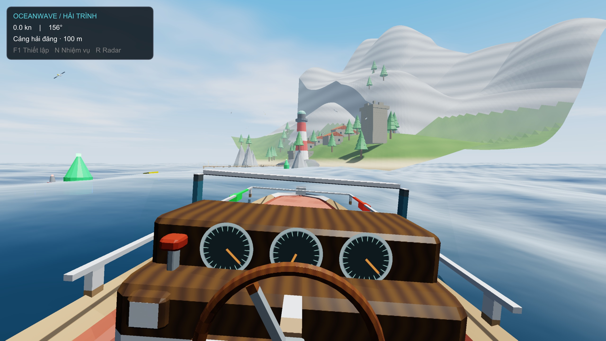
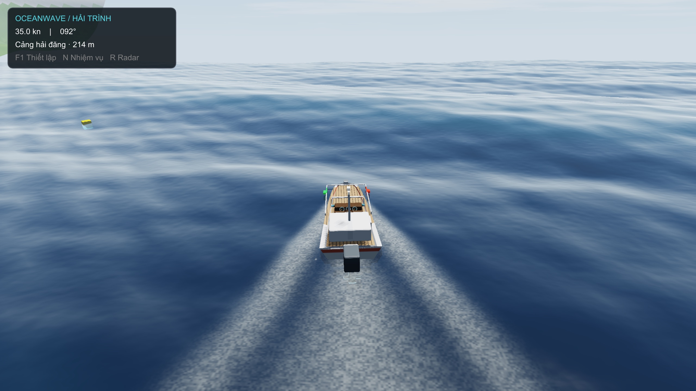

# OceanWave3D

Mô phỏng đại dương và lái tàu 3D thời gian thực bằng **C++17, OpenGL, GLFW, GLM, Dear ImGui và OpenAL**.

Dự án có mặt biển Gerstner, tàu điều khiển được với buồng lái, cầu cảng và hải đăng, radar mô phỏng, thời tiết và chế độ thu hồi hàng. Phiên bản hiện tại tập trung vào chất lượng dựng hình, HUD tiếng Việt và hiệu ứng nước rẽ hai mạn.

## Hình ảnh phiên bản hiện tại

### Buồng lái và HUD tiếng Việt



Vô lăng tròn ba chấu, cần ga có chuyển động, cụm đồng hồ và kính trong suốt. HUD mặc định hiển thị tốc độ, hướng và khoảng cách đến cảng; công cụ mô phỏng nằm trong bảng F1.

### Vệt nước khi tàu chạy và rẽ



Bọt phát sinh theo hướng, tốc độ và tiếp xúc nước của tàu. Hai nhánh chữ V lan ngang, lưu lại theo đường đi và tan dần khi tàu dừng.

Các hình ảnh cũ được giữ trong thư mục [`ss/`](ss/).

## Những cải tiến đã hoàn thành

### Dựng hình và môi trường

- Dựng cảnh và phản xạ trong **linear HDR**; áp dụng ACES và chuyển sang sRGB một lần ở postprocess. Có điều chỉnh phơi sáng.
- Sửa uniform độ phân giải lưới biển, tránh gán nhầm kiểu với kích thước màn hình.
- Bóng mặt trời dùng depth map, PCF và bias theo góc mặt nhận bóng; sương thay đổi theo khoảng cách và mưa.
- Thêm lọc cạnh nhẹ ở Medium/High, giảm chi tiết mặt nước không còn phân giải được ở xa.
- Bo cạnh các phần chính của tàu; hoàn thiện vô lăng, cần ga và mặt đồng hồ riêng.
- Kính được vẽ bằng alpha blending sau các vật thể đặc; giọt nước và gạt nước giới hạn theo mặt kính trước được chiếu ra màn hình.
- Cây có tán nón, nhà có mái hai dốc và cửa sổ riêng. Vị trí cây/nhà lấy cao độ từ địa hình; cát và cỏ chuyển màu theo cao độ/độ dốc.

### Sóng, bọt và tương tác với tàu

- 16 thành phần sóng Gerstner, đạo hàm và Jacobian trên GPU.
- Lấy độ cao nước tại tọa độ thế giới bằng phép đảo Gerstner; giới hạn dốc ngang để tránh mặt nước gập khi tăng biên độ.
- Vật lý nổi nhiều điểm và bước cập nhật tàu cố định **120 Hz**.
- Hai nhánh nước rẽ chữ V và vệt chân vịt riêng, thay cho mảng bọt hình nón gắn cứng vào tàu.
- Trường bề mặt **120m** lưu độ phủ bọt, gợn nổi và vận tốc lan ngang trong hai texture RGBA16F ping-pong hiện có.
- Dịch miền theo bước nguyên texel để giữ vệt; reset/teleport xa xóa trường để tránh nối đường bọt giả.
- Bọt mịn, tia nước nhỏ phun ra hai mạn từ phần thân chạm nước; hạt chịu trọng lực và biến mất khi rơi xuống biển.
- Đứng yên không phát sinh wake mới; bọt cũ tiếp tục tan. Gợn tác động nhẹ lên độ cao và normal mặt nước.

### Trải nghiệm và hiệu năng

- HUD tiếng Việt thu gọn; radar mặc định ẩn, có bảng thiết lập và menu nhiệm vụ riêng.
- Font hỗ trợ tiếng Việt được rasterize theo mật độ màn hình lúc khởi động.
- Chặn điều khiển tàu khi ImGui đang nhận bàn phím.
- Cache uniform location theo shader program; tái sử dụng bộ đệm mưa.
- Các mức **Low / Medium / High** điều chỉnh biển, bóng, SSR, bọt, mưa và ngân sách hạt nước.
- Shader assets được tìm theo vị trí executable, hỗ trợ khởi chạy từ thư mục khác.
- Script macOS xác định vị trí dự án, build Release và chuyển tiếp tham số dòng lệnh.

## Điều khiển

| Phím | Chức năng |
|---|---|
| **W / S** | Tiến / lùi, tăng hoặc giảm tốc theo cơ chế hiện tại |
| **A / D** | Rẽ trái / phải |
| **C** | Chuyển camera: theo tàu → buồng lái → orbit |
| **Phím mũi tên** | Xoay camera orbit |
| **Q / Z** | Thu / giãn khoảng cách camera orbit |
| **E** | Neo / tháo neo khi ở vị trí phù hợp |
| **W khi đã neo** | Tháo neo để khởi hành |
| **R** | Hiện / ẩn radar |
| **M** | Đổi thời tiết: quang đãng → nhiều mây → mưa → bão |
| **F** | Bật / tắt đèn pha |
| **K** | Bật / tắt gạt nước |
| **F1** | Thiết lập chất lượng, phơi sáng, giờ, sóng, âm thanh và thông số vật lý |
| **N** | Menu nhiệm vụ, bắt đầu lại hoặc trở về lái tự do |
| **Esc** | Thoát |

### Cập bến

1. Nhấn **R**, tìm nhãn `BEN TAU` trên radar. Cầu cảng nằm gần hải đăng, quanh tọa độ `(61, -105)`.
2. Giảm tốc khi tiếp cận. Điều kiện neo hiện tại là khoảng cách đến đường tâm cầu cảng dưới **16m** và tốc độ tuyệt đối dưới **2.8m/s**, khoảng **5.4 knots**.
3. Khi HUD báo có thể neo, nhấn **E**. Tàu được căn về bến, giữ vị trí ngang và tiếp tục dập dềnh theo sóng.
4. Nhấn **E** hoặc **W** để khởi hành.

Chế độ nhiệm vụ hiện tại yêu cầu thu hồi **10 thùng hàng trong 60 giây**. Mở bằng **N**; dùng radar để tìm hàng và đưa tàu đến gần để thu hồi.

## Build và khởi chạy

Yêu cầu: trình biên dịch C++17, CMake **3.16+**, GLFW **3.3+**, GLM, OpenAL và driver OpenGL Core phù hợp. Shader dùng GLSL 330; bản macOS đã chạy thực tế trên OpenGL 4.1 Metal của Apple M1 Pro.

### macOS

```bash
brew install cmake glfw glm
./run_mac.sh
```

Script dùng `build-macos/` và cấu hình Release. Có thể truyền các cờ kiểm tra, ví dụ `./run_mac.sh --self-test`.

Build thủ công:

```bash
cmake -S . -B build-macos -DCMAKE_BUILD_TYPE=Release
cmake --build build-macos -j 4
./build-macos/OceanWave3D
```

OpenAL dùng framework có sẵn của hệ thống. Nếu di chuyển dự án, hãy dùng thư mục build mới để tránh CMake cache còn đường dẫn cũ.

### Linux — Ubuntu/Debian

```bash
sudo apt update
sudo apt install build-essential cmake libglfw3-dev libglm-dev libopenal-dev libgl1-mesa-dev
cmake -S . -B build -DCMAKE_BUILD_TYPE=Release
cmake --build build -j 4
./build/OceanWave3D
```

### Windows

Cài GLFW, GLM và OpenAL, bảo đảm CMake tìm thấy các thư viện qua package configuration hoặc toolchain của trình quản lý phụ thuộc đang dùng.

```powershell
cmake -S . -B build
cmake --build build --config Release
.\build\Release\OceanWave3D.exe
```

CMake có cấu hình cho cả ba nền tảng; các thay đổi mới đã được kiểm tra trên macOS, chưa được xác minh trên Windows/Linux.

### Font tiếng Việt

Ứng dụng tìm font theo thứ tự:

1. `assets/fonts/DejaVuSans.ttf` nếu được cung cấp.
2. Arial hệ thống trên macOS.
3. DejaVu Sans hệ thống trên Linux.
4. Segoe UI hệ thống trên Windows.

Repository không phân phối lại font hệ thống. Khi bổ sung font vào assets, kèm giấy phép phù hợp. Nếu chuyển sang màn hình có DPI khác, nên khởi động lại để tạo lại font atlas.

## Mức chất lượng

| Mức | Lưới biển | Shadow map | Texture bọt | SSR | Vệt mưa | Ngân sách hạt nước |
|---|---:|---:|---:|---|---:|---:|
| Low | 160 × 160 | 512² | 256² | Tắt | 450 | 400 |
| Medium | 240 × 240 | 1024² | 512² | 8 bước | 900 | 900 |
| High | 320 × 320 | 2048² | 768² | 12 bước | 1500 | 1500 |

Chọn mức trong **F1**. Medium/High có bộ lọc cạnh không gian nhẹ; chưa có temporal antialiasing.

## Kiểm thử và chụp ảnh

Ví dụ dưới đây dùng thư mục build macOS; thay đường dẫn executable cho nền tảng tương ứng.

```bash
ctest --test-dir build-macos --output-on-failure
./build-macos/OceanWave3D --self-test
./build-macos/OceanWave3D --smoke
./build-macos/OceanWave3D --frames 360 --view 1 --hour 13.5 --quality 1 --capture /tmp/ocean-cockpit.ppm
```

| Cờ | Ý nghĩa |
|---|---|
| `--self-test` | Kiểm tra đảo sóng, cân bằng nổi, ga, ràng buộc neo và chặn bàn phím ImGui; không mở cửa sổ đồ họa |
| `--smoke` | Chạy chuỗi thao tác, resize, đổi chất lượng và kiểm tra lỗi OpenGL trong 360 khung |
| `--frames N` | Giới hạn số khung, dùng bước thời gian mô phỏng cố định |
| `--view 0/1/2` | Theo tàu / buồng lái / orbit |
| `--hour H` | Giờ trong ngày khi review |
| `--quality 0/1/2` | Low / Medium / High khi review |
| `--weather 0/1/2/3` | Quang đãng / nhiều mây / mưa / bão khi review |
| `--settings`, `--spotlight` | Mở thiết lập hoặc bật đèn khi review |
| `--capture PATH.ppm` | Lưu framebuffer thành PPM; thư mục đích phải có sẵn |
| `--wake-review MODE` | Kịch bản wake: `straight`, `turn`, `idle`, `reverse`, `stop` |

Kiểm tra riêng vệt nước:

```bash
./build-macos/OceanWave3D --wake-review straight --view 2 --frames 360
./build-macos/OceanWave3D --wake-review turn --view 2 --frames 360 --capture /tmp/ocean-turn.ppm
./build-macos/OceanWave3D --wake-review idle --frames 360
./build-macos/OceanWave3D --wake-review reverse --frames 360
./build-macos/OceanWave3D --wake-review stop --view 2 --frames 720
```

Chế độ wake đọc dữ liệu GPU để kiểm tra giá trị hữu hạn, bọt ở cả hai mạn khi chạy thẳng/lùi, không phát bọt khi đứng yên và độ tan sau khi dừng. Các lượt kiểm tra đã qua trên M1 Pro; kịch bản dừng còn khoảng **8%** độ phủ bọt sau 9 giây không phát thêm.

Review bỏ 30 khung đầu và dùng `glFinish` để đo thời gian CPU + GPU hoàn tất khung, chưa gồm swap/vsync. Đây không phải FPS chơi thực tế hay thời gian GPU riêng từng pass. Gameplay bình thường không gọi `glFinish` và không đọc lại trường wake từ GPU. Log, bản build và ảnh kiểm tra trung gian được giữ cục bộ trong các thư mục bị Git bỏ qua.

## Kiến trúc

```text
assets/shaders/       GLSL cho biển, vật thể, bóng, trời, mưa và postprocess
src/core/            Cửa sổ, camera, input, self-test và review harness
src/renderer/        Shader/uniform cache, mesh, HDR framebuffer, ánh sáng và hạt
src/ocean/           Gerstner CPU/GPU, lưới biển và trường wake ping-pong
src/game/            Tàu/vật lý, cảng, đất liền, phao, radar, thời tiết và nhiệm vụ
src/audio/           Âm thanh thủ tục OpenAL
src/main.cpp         Ghép các hệ thống và điều phối các lượt dựng hình
ss/                  Ảnh minh họa
```

Pipeline: **shadow map → cảnh màu/độ sâu cho SSR → tổng hợp biển và vật thể trong HDR → postprocess ACES/sRGB → ImGui**. Trường wake cập nhật trước các lượt dựng cảnh. Vật lý nổi dùng cùng mô hình sóng cơ sở với mặt biển.

## Giới hạn và hướng tiếp theo

- Mô hình thủ tục và địa hình vẫn có phong cách ít đa giác; còn dư địa cải thiện vật liệu và hình học.
- Wake là mô hình hiệu ứng bề mặt nhẹ, chưa phải bộ giải chất lỏng 3D; lực từ vệt sóng chưa tác động ngược lên thân tàu.
- SSR phụ thuộc dữ liệu trên màn hình; shadow map có vùng phủ hữu hạn quanh tàu.
- Đồng hồ phải ước tính vòng tua theo tốc độ, chưa có mô hình động cơ độc lập. Gạt nước là hiệu ứng màn hình được giới hạn trên kính trước.
- Va chạm bờ/cầu cảng, cải thiện ga/quán tính, camera mượt hơn và lưu thiết lập là các hướng phát triển tiếp theo.

## Giấy phép

Dự án được công bố theo **MIT License** trong README ban đầu.
